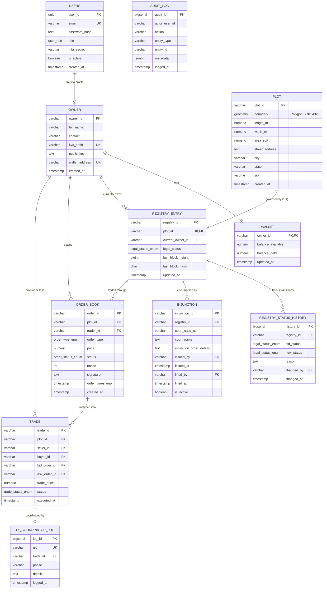
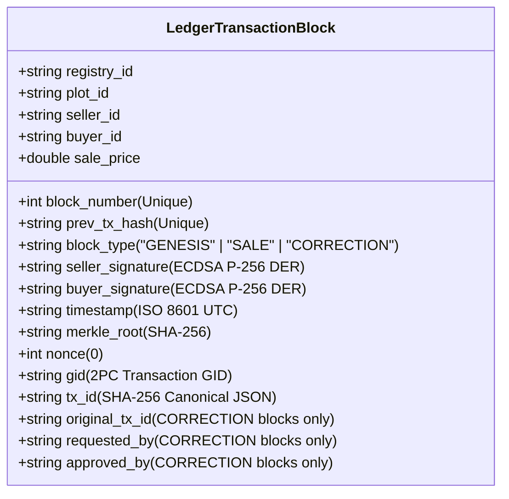

# Land Exchange: Entity-Relationship (ER) Architecture

**Course:** DBMS CD252IA, RVCE (2026)  
**Project:** Decentralized Land Registry & Peer-to-Peer Real Estate Exchange  
**Implementation Source:** [`sql/001_schema.sql`](file:///c:/Users/DELL/Downloads/New%20folder/PROJECTS/LANDREGISTRY/sql/001_schema.sql), [`scripts/mongo_init.js`](file:///c:/Users/DELL/Downloads/New%20folder/PROJECTS/LANDREGISTRY/scripts/mongo_init.js)

---

## 1. Hybrid Polyglot Persistence Architecture

The Land Exchange uses a hybrid database design:
1. **Relational / Spatial Store (PostgreSQL 16 + PostGIS):** Manages relational integrity, user identities, wallets, parcel spatial geometry, current legal state, injunctions, and the real-time order book.
2. **Document / Ledger Store (MongoDB 7.0):** Acts as an immutable, append-only cryptographic ledger of title events and sale settlements.

---

## 2. PostgreSQL Relational & Spatial Entity-Relationship Diagram

---

## 3. MongoDB Cryptographic Ledger Collection Schema

The append-only ledger collection [`ledger_transaction_block`](file:///c:/Users/DELL/Downloads/New%20folder/PROJECTS/LANDREGISTRY/scripts/mongo_init.js) models sequential title deed transactions sealed with ECDSA P-256 signatures:

---

## 4. Cross-Store Linkage

The bridge between PostgreSQL and MongoDB maintains complete data consistency without dual-master fragility:
1. `registry_entry.last_block_height` points to `ledger_transaction_block.block_number`.
2. `registry_entry.last_block_hash` mirrors `ledger_transaction_block.tx_id`.
3. `tx_coordinator_log.gid` matches `ledger_transaction_block.gid` for two-phase commit DvP (Delivery vs Payment) atomicity.
4. If an in-doubt state occurs during network partitions, PostgreSQL queries MongoDB by `gid` to resolve whether to `COMMIT PREPARED` or `ROLLBACK PREPARED`.
